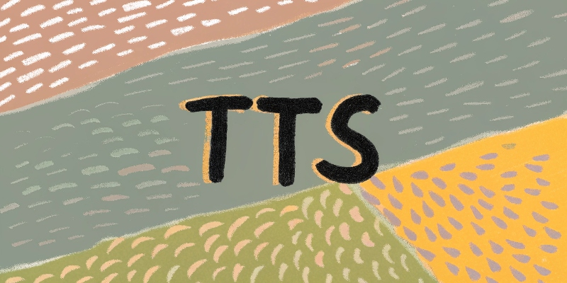
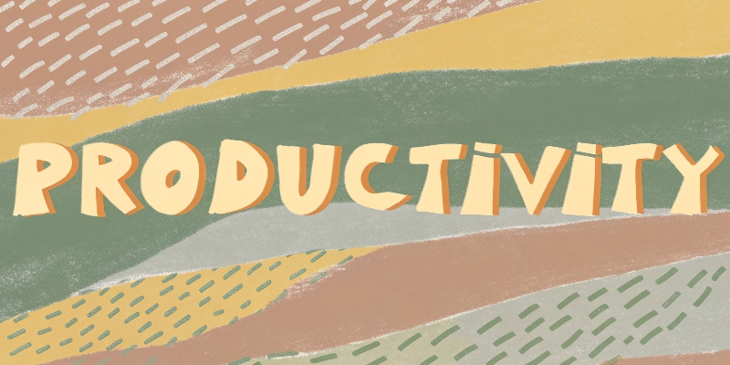
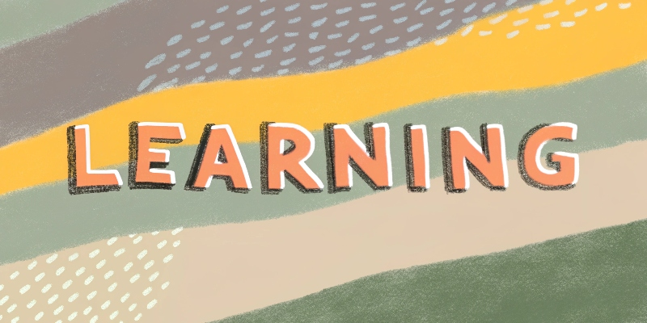

<h1>一人公司</h1>

一人公司 AI 工具系列，有些工具是宝，有些工具是坑

本 Repo 致力于帮您踩坑，精准找宝 🤩

欢迎点🌟 | 收藏🔖 | 转发🫰

[![GitHub stars][star-shield]][star-link]
[![GitHub forks][fork-shield]][fork-link]
[![GitHub issues][issue-shield]][issue-link]
[![GitHub pull requests][pr-shield]][pr-link]
[![GitHub license][license-shield]][license-link]

[![English Version][en-shield]][en-link]

 

  
<kbd>目录</kbd>

  ### 目录

- [🤖 大语言模型](#-大语言模型)
  - [店长推荐 TOP3](#-店长推荐-top3)
  - [查看详细内容](#)
- [🎙️ TTS](#️-tts)
  - [店长推荐 TOP3](#-店长推荐-top3-1)
  - [查看详细内容](#)
- [💻 代码](#-代码)
  - [店长推荐 TOP3](#-店长推荐-top3-2)
  - [查看详细内容](#)
  - [全栈开发与快速构建](#全栈开发与快速构建)
  - [代码理解与文档](#代码理解与文档)
- [🎨 设计工具](#-设计工具)
  - [店长推荐 TOP3](#-店长推荐-top3-3)
  - [查看详细内容](#)
- [⚙️ 生产力工具](#-生产力工具)
  - [店长推荐 TOP3](#-店长推荐-top3-4)
  - [查看详细内容](#)
- [🌐 网站系列](#网站系列---一键生成网站)
  - [店长推荐 TOP3](#-店长推荐-top3-5)
  - [查看详细内容](#)
- [📚 学习系列](#-学习系列)
  - [查看详细内容](#)
- [👻 恶搞系列](#恶搞系列)
  - [查看详细内容](#)

 

## 🤖 大语言模型

### 🏆 店长推荐 TOP3
| 模型 | 特点 | 排名 |
|------|------|------|
| [Claude 3.7 Sonnet (Anthropic)](https://www.anthropic.com/) | 多功能通用、知识更新快 | WebDev Arena 🥇 #1 |
| [Gemini-2.5-Pro (Google)](https://deepmind.google/technologies/gemini/) | 逻辑推理强、支持多模态 | WebDev Arena 🥈 #2 |
| [DeepSeek-V3 (DeepSeek)](https://github.com/deepseek-ai/) | 开发能力优秀、代码质量高 | WebDev Arena 🏅 #4 |

 

<b>查看详细内容</b>

在日常使用中，我会经常切换不同的大语言模型来获取更全面的答案。目前我主要使用 Claude 3.7 Sonnet 和 Gemini 2.5 Pro，这两个模型在各方面都表现出色。当遇到需要进一步验证的问题时，我也会使用 DeepSeek 和 Grok 来交叉对比，以获得更准确的答案。

#### 📊 WebDev Arena 实时排行
https://web.lmarena.ai/leaderboard
| 模型 | Chatbot Arena 排名 | Source |
|------|---------------------|--------|
| [Claude 3.7 Sonnet (Anthropic)](https://www.anthropic.com/) | 🥇 #1                 | [LMArena](https://web.lmarena.ai/leaderboard) |
| [Gemini-2.5-Pro-Exp-03-25 (Google)](https://deepmind.google/technologies/gemini/) | 🥈 #2                 | [LMArena](https://web.lmarena.ai/leaderboard) |
| [Claude 3.5 Sonnet (Anthropic)](https://www.anthropic.com/index/claude-3-5-sonnet) | 🥉 #3                 | [LMArena](https://web.lmarena.ai/leaderboard) |
| [DeepSeek-V3-0324 (DeepSeek)](https://github.com/deepseek-ai/) | 🏅 #4                 | [LMArena](https://web.lmarena.ai/leaderboard) |
| [early-grok-3 (xAI)](https://x.ai) | 🏅 #6                 | [LMArena](https://web.lmarena.ai/leaderboard) |
| [GPT-4o-2024-11-20 (OpenAI)](https://openai.com/chatgpt) | 🏅 #20                | [LMArena](https://web.lmarena.ai/leaderboard) |
| [Alama (评测平台)](https://alama.ai) | ✅ 模型对比聚合平台 | -      |

 

#### 📊 Chatbot Arena 实时排行
https://web.lmarena.ai/leaderboard

| 模型 | Chatbot Arena 排名 (UB) | Source |
|------|-------------------------|--------|
| [Gemini-2.5-Pro-Exp-03-25 (Google)](https://deepmind.google/technologies/gemini/) | 🥇 #1                     | [LMArena](https://web.lmarena.ai/leaderboard) |
| [ChatGPT-4o-latest (OpenAI)](https://openai.com/chatgpt) | 🥈 #2                     | [LMArena](https://web.lmarena.ai/leaderboard) |
| [Grok-3-Preview-02-24 (xAI)](https://x.ai) | 🥈 #2                     | [LMArena](https://web.lmarena.ai/leaderboard) |
| [GPT-4.5-Preview (OpenAI)](https://openai.com/) | 🥈 #2                     | [LMArena](https://web.lmarena.ai/leaderboard) |
| [Gemini-2.0-Flash-Thinking-Exp-01-21 (Google)](https://deepmind.google/technologies/gemini/) | 🏅 #5                     | [LMArena](https://web.lmarena.ai/leaderboard) |
| [Gemini-2.0-Pro-Exp-02-05 (Google)](https://deepmind.google/technologies/gemini/) | 🏅 #5                     | [LMArena](https://web.lmarena.ai/leaderboard) |
| [DeepSeek-V3-0324 (DeepSeek)](https://github.com/deepseek-ai/) | 🏅 #5                     | [LMArena](https://web.lmarena.ai/leaderboard) |
| [DeepSeek-R1 (DeepSeek)](https://github.com/deepseek-ai/) | 🏅 #7                     | [LMArena](https://web.lmarena.ai/leaderboard) |
| [Gemini-2.0-Flash-001 (Google)](https://deepmind.google/technologies/gemini/) | 🏅 #8                     | [LMArena](https://web.lmarena.ai/leaderboard) |
| [o1-2024-12-17 (OpenAI?)](https://openai.com/) | 🏅 #8                     | [LMArena](https://web.lmarena.ai/leaderboard) |
| [Gemma-3-27B-it (Google)](https://huggingface.co/google/gemma-3-27b-it) | 🏅 #10                    | [LMArena](https://web.lmarena.ai/leaderboard) |
| [Qwen2.5-Max (Alibaba)](https://huggingface.co/Qwen/Qwen2.5-72B-Chat) | 🏅 #11                    | [LMArena](https://web.lmarena.ai/leaderboard) |
| [o1-preview (OpenAI?)](https://openai.com/) | 🏅 #11                    | [LMArena](https://web.lmarena.ai/leaderboard) |
| [Claude 3.7 Sonnet (Anthropic)](https://www.anthropic.com/) | 🏅 #22                    | [LMArena](https://web.lmarena.ai/leaderboard) |

[![][back-to-top]](#readme-top)

 

## 🎙️ TTS

### 🏆 店长推荐 TOP3
| 服务 | 特点 | 价格 |
|------|------|------|
| [Microsoft Azure TTS](https://azure.microsoft.com/en-us/products/cognitive-services/text-to-speech/) | 多语言支持、情感语调强大、流式播放 | 免费 5M 字符/月（前 12 个月） |
| [iFlytek 科大讯飞](https://www.xfyun.cn/services/online_tts) | 中文语音第一、多场景支持、音色丰富 | ¥0.2/千字符 |
| [ElevenLabs](https://elevenlabs.io/) | 角色感强、音质好、支持情绪变化 | $11/百万字符起 |

 

<b>查看详细内容</b>

### 🏢 商业 TTS 服务（英文 + 多语言）

#### 1. [Microsoft Azure TTS](https://azure.microsoft.com/en-us/products/cognitive-services/text-to-speech/)
- 多语言语音合成服务
- 支持 SSML 控制、情绪语调、流式播放
- 免费 5M 字符/月（前 12 个月）

#### 2. [Google Cloud TTS](https://cloud.google.com/text-to-speech)
- WaveNet / Neural2 语音技术
- 支持中文普通话和台语，多种声音选择
- 免费 4M 字符/月（前 12 个月）

#### 3. [Amazon Polly](https://aws.amazon.com/polly/)
- 可部署在 AWS 各产品中
- 支持多语言、Speech Marks（断句）
- 免费 5M 字符/月（前 12 个月）

#### 4. [IBM Watson TTS](https://www.ibm.com/cloud/watson-text-to-speech)
- 支持多语种语音合成
- 提供企业级服务

#### 5. [ElevenLabs](https://elevenlabs.io/)
- 支持情绪变化与角色风格
- 提供英文和中文语音合成
- 支持语音克隆和流式播放 API

#### 6. [PlayHT](https://play.ht/)
- Web 端流式 TTS 服务
- 提供免费使用额度

#### 7. [OpenAI TTS](https://platform.openai.com/docs/guides/text-to-speech)
- 支持 Whisper 语音识别对接
- 中文支持待完善

#### 8. [Deepgram](https://deepgram.com/product/text-to-speech)
- 实时流式语音合成
- 支持多语言和声音风格
- 提供试用额度

#### 9. [Neuphonic](https://neuphonic.ai)
- 多语言语音合成服务
- 提供 API 和 SDK
- 有免费试用

#### 10. [Murf AI](https://murf.ai/)
- 配音和画外音制作工具
- 支持 120+ 种声音和 20+ 种语言
- 提供试用版本

#### 11. [Resemble AI](https://www.resemble.ai/)
- 语音克隆技术
- 实时语音合成
- 企业级 API 服务

 

### 🇨🇳 中文 TTS 服务

#### 1. [iFlytek 科大讯飞](https://www.xfyun.cn/services/online_tts)
- 中文语音合成服务
- 支持流式合成、自定义音色、音色克隆
- 应用于教育、客服、阅读等场景

#### 2. [Baidu TTS](https://ai.baidu.com/tech/speech/tts)
- 提供离线 SDK 与云服务
- 面向企业级语音交互应用

#### 3. [MiniMax TTS](https://blog.fal.ai/minimax-text-to-speech-models-now-available-on-fal/)
- 实时语音合成服务
- 支持多语言音色
- 适用于 AI Agent 场景

#### 4. ByteDance（字节跳动）SeedTTS / MegaTTS3
- 内部语音合成技术
- 支持语音克隆和情绪表达
- 用于公司产品（抖音、剪映）

#### 5. [Cartesia Sonic TTS](https://cartesia.ai/product/text-to-speech-tts)
- 低延迟语音合成
- 支持音色克隆
- 适用于医疗、客服等领域

#### 6. [Fish Speech](https://github.com/fishaudio/fish-speech)
- 开源语音合成系统
- 支持多语言和音色克隆
- 提供流式推理

#### 7. [CosyVoice (阿里巴巴)](https://github.com/FunAudioLLM/CosyVoice)
- 开源多语言语音合成系统
- 支持情感语调和多语种
- 轻量化部署方案

#### 8. [火山引擎 TTS](https://www.volcengine.com/product/speech-tech)
- 中英文双语支持
- 提供流式合成和离线 SDK
- 企业级服务

 

### 🔓 开源/自部署 TTS 方案

#### 1. [Fish Speech](https://github.com/fishaudio/fish-speech)
- 支持 8 种语言
- 提供音色克隆功能
- 支持流式播放部署

#### 2. [CosyVoice (阿里)](https://github.com/FunAudioLLM/CosyVoice)
- 多语言支持
- 提供流式推理
- 轻量化部署方案

#### 3. [Coqui TTS](https://github.com/coqui-ai/TTS)
- 支持中文模型配置
- 可进行模型训练和微调
- 开源社区维护

#### 4. [Mimic (Mycroft AI)](https://github.com/MycroftAI/mimic1)
- 轻量级语音合成系统
- 适用于嵌入式设备

#### 5. [Bark (by Suno)](https://github.com/suno-ai/bark)
- 支持多模态输出
- 非流式生成模式

#### 6. [Tortoise TTS](https://github.com/neonbjb/tortoise-tts)
- 高质量语音合成
- 非实时生成模式

#### 7. [VITS](https://github.com/jaywalnut310/vits)
- 端到端语音合成
- 支持多语言训练
- 社区持续改进

#### 8. VoiceCanvas
- 支持 50+ 种语言和方言的文本转语音，提供多种男声和女声选择
- 个性化声音克隆：仅需 10 秒音频样本即可创建专属 AI 声音，支持跨语言使用
- 高级功能：语速调节、音频可视化、逐字朗读模式、一键下载音频文件
- 灵活的订阅计划：免费试用、按月/按年订阅、按量付费选项
- 支持自部署，代码 100% 开源，适合开发者和内容创作者使用

 

### 📊 功能对比表（中英文 TTS）

| 名称            | 中文 | 英文 | 流式 | 克隆 | 开源 | 特点                 | 价格 |
|-----------------|------|------|------|------|------|----------------------|------|
| Azure TTS       | ✅✅✅ | ✅✅✅ | ✅   | ❌   | ❌   | 商业标准，情感支持强 | $4/百万字符 |
| Google TTS      | ✅✅  | ✅✅✅ | ⚠️   | ❌   | ❌   | 稳定好用             | $4/百万字符 |
| iFlytek         | ✅✅✅ | ✅    | ✅   | ✅   | ❌   | 中文第一             | ¥0.2/千字符 |
| MiniMax         | ✅✅  | ✅    | ✅   | ✅   | ❌   | 适合 Agent           | ¥0.3/千字符 |
| Baidu TTS       | ✅✅  | ❌    | ✅   | ❌   | ❌   | 企业级可落地         | ¥0.2/千字符 |
| ByteDance TTS   | ✅✅✅ | ✅    | ✅   | ✅✅ | ❌   | 中文高保真 + 情绪    | 内部使用 |
| Cartesia Sonic  | ✅✅✅ | ✅    | ✅✅ | ✅✅ | ❌   | 高速、准确、可控     | 企业定制 |
| ElevenLabs      | ⚠️    | ✅✅✅ | ✅   | ✅   | ❌   | 角色感强，音质好     | $11/百万字符起 |
| Murf AI         | ❌    | ✅✅✅ | ✅   | ✅   | ❌   | 专业配音级           | $13/月起 |
| Resemble AI     | ⚠️    | ✅✅  | ✅   | ✅✅ | ❌   | 克隆技术领先         | 企业定制 |
| 火山引擎 TTS    | ✅✅  | ✅    | ✅   | ❌   | ❌   | 企业级服务           | ¥0.3/千字符 |
| Fish Speech     | ✅✅  | ✅    | ✅   | ✅   | ✅   | 快速开源部署         | 波动 |
| CosyVoice       | ✅✅  | ✅    | ✅   | ✅   | ✅   | 多语 + 轻量          | 波动 |
| Coqui TTS       | ✅（需配置）| ✅ | ⚠️   | ✅   | ✅   | 可训练，社区活跃     | 波动 |
| Bark            | ✅    | ✅    | ❌   | ✅   | ✅   | 情绪丰富，生成慢     | 波动 |
| Tortoise TTS    | ✅    | ✅✅  | ❌   | ✅   | ✅   | 高质量非实时输出     | 波动 |
| VITS            | ✅    | ✅    | ⚠️   | ✅   | ✅   | 端到端训练           | 波动 |

[![][back-to-top]](#readme-top)

 

## 💻 代码

### 🏆 店长推荐 TOP3
| 工具 | 特点 | 价格 |
|------|------|------|
| [Cursor](https://cursor.com) | AI 辅助开发、代码补全、上下文理解强 | 基础功能免费 |
| [Deepwiki.com](http://Deepwiki.com) | 自动生成代码文档、理解项目结构、支持私有仓库 | 免费 |
| [Tempo](https://tempo.new) | 快速构建全栈项目、支持后端+前端+Auth+支付 | 免费 |

 

<b>查看详细内容</b>

- **IDE**
  - [TRAE][trae-link]
  - [Cursor][cursor-link]
    - AI 辅助开发
    - 3.7 免费用 + 免费
  - [VS Code][vscode-link]
    - 开源免费
    - 插件丰富
  - [Windsurf][windsurf-link]
    - 轻量级开发工具
    - 完全免费

- **命令行终端**
  - [Warp][warp-link]
    - AI 增强终端
    - 提供免费额度

### 代码理解与文档
- [Deepwiki.com](http://Deepwiki.com)
  - 📝 自动为你的代码生成技术文档、函数说明、API 注释
  - 🧠 支持自然语言提问，理解代码上下文含义
  - 🧩 可生成"项目百科"，结构清晰、层级分明
  - 🕵️ 适合快速上手新项目、提升文档覆盖率
  - 🔒 支持私有仓库，数据安全

- [gitsummarize](https://github.com/antarixxx/gitsummarize)
  - 📄 架构级概览
  - 📁 目录 & 文件总结
  - 🧠 用自然语言解释代码目的、流程与结构
  - 🔗 提取业务逻辑与规则
  - 📊 自动绘制架构图与流程图

- [gitdiagram.com](https://gitdiagram.com)
  - 🧠 支持大型代码仓库的全局理解
  - 🏗️ 可视化展示文件结构、模块依赖、函数关系
  - 🔍 点击任意节点即可查看源码详情
  - 🤝 支持团队共享与嵌入文档
  - 🚀 极简输入 GitHub 链接即可开始分析

### 全栈开发与快速构建
- [Tempo](https://tempo.new)
  - 后端 + 前端 + Auth + 支付
- [Chef](https://chef.convex.dev)
  - 后端 + 前端 + Auth
- [Vibe Code App](https://apps.apple.com/us/app/vibecode/id6742912146)
  - App
- [v0](https://v0.dev)
  - 前端/Apps/Games
- [Bolt](https://bolt.new)
  - 前端/Apps/Games
- [Lovable](https://lovable.dev)
  - 前端/Apps/Games
- [Firebase Studio](https://firebase.google.com)
  - 前端/Apps/Games
- [Devin](https://devin.ai)
  - 前端/Apps/Games
- [HeyBoss](https://heybossai.com)
  - 前端/Apps/Games
- [Replit](https://replit.com)
  - 前端/Apps/Games
- [Same](https://same.dev)
  - 前端/Apps/Games
- [a0](https://a0.dev)
  - 前端/Apps/Games
- [Vibe Coder](https://vibecoder.gg)
  - 前端/Apps/Games
- [ShipAny](https://shipany.ai)
  - 前端/Apps/Games
- [CopyWeb](https://copyweb.ai)
  - 前端/Apps/Games
- [Seede](https://seede.ai)
  - 前端/Apps/Games
- [Magic Patterns](https://magicpatterns.com)
  - AI 原型设计平台，用于产品团队快速构建原型、获取用户反馈并进行数据驱动决策。

[![][back-to-top]](#readme-top)

 

## 🎨 设计工具

### 🏆 店长推荐 TOP3
| 工具 | 特点 | 价格 |
|------|------|------|
| [Recraft.ai](https://www.recraft.ai) | 全能设计神器、支持Logo、图片、MockUp、Banner、提供模板和风格定制 | 每天免费 100 次生成额度 |
| [Canva](https://www.canva.com) | 海量模板一键修改、支持文档/白板/社媒/视频等多种格式 | 绑卡免费 30 天 |
| [Finisher](https://finisher.co/lab/header/) | AI 生成沉浸式网页头图、多种风格模板、一键适配 | 免费 |

 

<b>查看详细内容</b>

### 全能设计
| 工具 | 特点 | 定价 |
|------|------|------|
| [Recraft.ai][recraft-link] | 🔥🔥🔥 强烈推荐 支持 Logo、图片、MockUp、Banner 提供模板和风格定制 | 每天免费 100 次生成额度 |

### 运营设计
| 工具 | 特点 | 定价 |
|------|------|------|
| [Canva][canva-link] | 支持文档、白板、社媒、视频等 海量模板一键修改 | 绑卡免费 30 天 |

### 网站设计
| 工具 | 特点 | 定价 |
|------|------|------|
| [Relume][relume-link] | 一句话生成完整网站 与 Figma 无缝集成 | 绑卡免费 30 天 |
| [Finisher](https://finisher.co/lab/header/) | AI 生成沉浸式网页头图 多种风格模板可选 自动适配文案、CTA、背景图 即用即改，适合开发者、设计师、创作者 | 免费 |

### 3D 设计
| 工具 | 特点 | 定价 |
|------|------|------|
| [Blender][blender-link] | 支持 AI 控制 [MCP 控制器][blender-mcp-link] | 完全开源免费 |
| [Spline][spline-link] | 社区免费模板 支持网页端设计 快速上手 | 免费使用 |

### 动态设计
| 工具 | 特点 | 定价 |
|------|------|------|
| [Jitter][jitter-link] | 专注 Hero 动画 简单易用 | 免费版够用 |
| [HailuoAI][hailuo-link] | 支持多种动态效果 适合社媒内容 | 免费版够用 |
| [KlingAI][kling-link] | AI 驱动转换 社媒优化 | 免费版够用 |

### 工作流设计
| 工具 | 特点 | 定价 |
|------|------|------|
| [Overflow][overflow-link] | 界面美观 支持交互展示 | 免费下载使用 |

### Logo 设计
| 工具 | 特点 | 定价 |
|------|------|------|
| [Fiverr][fiverr-link] | 专业设计平台 | 付费服务 |
| [Design.com][design-link] | AI 生成 | 免费试用 |
| [AILogoGenerator][ailogo-link] | 简单快速 | 完全免费 |
| [LogoMakr][logomakr-link] | 自定义强 | 免费使用 |
| [LogoPony][logopony-link] | 风格多样 | 免费试用 |
| [Looka][looka-link] | 品牌套件 | 免费试用 |

[![][back-to-top]](#readme-top)

 

## ⚙️ 生产力工具

### 🏆 店长推荐 TOP3
| 工具 | 特点 | 价格 |
|------|------|------|
| [Raycast](https://www.raycast.com) | 高效启动器、工作流自动化、丰富插件 | 基础功能免费 |
| [PixPin](https://pixpin.cn) | 全能截图工具、OCR识别、录屏功能 | 免费 |
| [Karabiner](https://karabiner-elements.pqrs.org) | 键盘自定义神器、改键完全控制 | 开源免费 |

 

<b>查看详细内容</b>

### 系统增强
- [Raycast][raycast-link]
  - 🔥🔥🔥 强烈推荐
  - 快速启动器
  - 工作流自动化
  - 基础功能免费

- [Karabiner][karabiner-link]
  - 🔥🔥🔥 强烈推荐
  - 键盘自定义
  - 功能强大
  - 开源免费

- [Rectangle][rectangle-link]
  - 窗口管理工具
  - 快捷键操作
  - 完全免费

- [Ice][ice-link]
  - 工具栏增强
  - 轻量高效
  - 开源免费

### 媒体工具

- [PixPin][pixpin-link]
  - 🔥🔥🔥 强烈推荐
  - 全能截图工具
  - 支持 GIF 录制
  - OCR 文字识别
  - 丰富标注功能

- [Downie][downie-link]
  - 🔥 推荐
  - 视频下载工具
  - 支持多平台
  - 提供试用
  - 视频下载工具
  - 支持多平台
  - 提供试用

- [MotionShot][motionshot-link]
  - 专业演示录制
  - 交互式标注
  - $7/月或$140 终身

- [Cap](https://cap.so)
  - 开源 Loom 替代品
  - 屏幕录制与分享
  - [GitHub](https://github.com/CapSoftware/Cap)

- [Kap][kap-link]
  - GIF 录制工具
  - 简单易用
  - 开源免费

- [KeyCastr][keycastr-link]
  - 按键显示工具
  - 录制演示必备
  - 开源免费

- [OBS][obs-link]
  - 专业录屏软件
  - 直播推流
  - 开源免费

- [IINA][iina-link]
  - 现代视频播放器
  - 界面美观
  - 开源免费

- [Youtube Music 桌面端](https://github.com/th-ch/youtube-music)
  - 支持背景播放（王炸功能）
  - 内置 ad blocker 所以没广告
  - 内置下载器，支持离线下载
  - 跨平台，支持插件系统，很多插件
  - 免费

### 日常效率
- [Pastebot][pastebot-link]
  - 剪贴板管理
  - 历史记录
  - $13 终身授权

- [CleanShot][cleanshot-link]
  - 专业截图工具
  - 录屏功能
  - $29 终身授权

- [Setapp][setapp-link]
  - 应用订阅合集
  - 优质应用精选
  - $10/月订阅

- [Toolfolio](https://toolfolio.io)
  - 精选工具集合：平台精心挑选并分类整理了各类高质量工具，方便用户快速找到所需资源。
  - 多平台资源支持：提供适用于 Figma、Framer、Webflow 等平台的 UI 组件、模板和插件，助力设计与开发工作流。
  - AI 与自动化工具：涵盖视频生成、写作辅助、语音识别等 AI 工具，提升内容创作效率。
  - 定期更新与推荐：平台持续更新工具库，并通过博客和新闻通讯分享最新的工具和资源。
  - 免费

### Academic Writing & Document Translation

- [HumanPen](https://humanpen.net/)
  - Document-level Humanize (DOCX/PPTX/TXT), Translate (12 target languages, PDF/DOCX/PPTX/XLSX/EPUB/HTML/TXT), Condense (DOCX), Citation Format Correction (12 styles, DOCX), and Research Projects
  - Commercial credit-based SaaS (100 signup credits); no detector guarantees or ghostwriting
  - API: https://api.humanpen.net/v1/docs.md | Ethics: https://humanpen.net/ethics

[![][back-to-top]](#readme-top)

 

## 网站系列 - 一键生成网站

### 🏆 店长推荐 TOP3
| 工具 | 特点 | 价格 |
|------|------|------|
| [v0.dev](https://v0.dev) | 最快无水印、即时预览 | 免费 |
| [Lovable](https://lovable.dev) | 设计最好看、易于定制 | 免费 |
| [bolt.new](https://bolt.new) | 用户体验好、交互流畅 | 免费 |

 

<b>查看详细内容</b>

- [v0.dev][v0-link]
  - 耗时：2分钟
  - 特点：最快无水印
  - 价格：免费
  - 演示：[查看][v0-demo-link]

- [lovable][lovable-link]
  - 耗时：3分钟
  - 特点：最好看
  - 价格：免费
  - 演示：[查看][lovable-demo-link]

- [bolt.new][bolt-link]
  - 耗时：3分钟
  - 特点：体验好
  - 价格：免费
  - 演示：[查看][bolt-demo-link]

- [heyboss][heyboss-link]
  - 耗时：12分钟
  - 特点：送$10
  - 价格：免费
  - 演示：[查看][heyboss-demo-link]

- [replit][replit-link]
  - 耗时：4分钟
  - 特点：$25/月额度
  - 价格：需绑卡
  - 演示：-

[![][back-to-top]](#readme-top)

 

## 📚 学习系列

 

[![][back-to-top]](#readme-top)

 

## 恶搞系列

 NaaS - No as a Service
  - 亮点
    - 🧱 它不提供服务
    - 🛑 它不解决问题
    - 🚫 它什么也不做
  - 然而，它非常认真地构建了一个完整的 CI/CD 流水线，只为上线一个……啥也不干的服务，天才恶搞！👀
  - Github 1: [hotheadhacker/no-as-a-service](https://github.com/hotheadhacker/no-as-a-service)
  - Github 2: [gotev/no-as-a-service](https://github.com/gotev/no-as-a-service)
  - 价格：免费

 

[![][back-to-top]](#readme-top)

<!-- Shields -->
[back-to-top]: https://img.shields.io/badge/-Back_to_top-gray?style=flat-square
[star-shield]: https://img.shields.io/github/stars/cyfyifanchen/one-person-company?style=flat-square&logo=github&color=FFD700&logoColor=white&logoBackground=FFA500
[star-link]: https://github.com/cyfyifanchen/one-person-company/stargazers
[fork-shield]: https://img.shields.io/github/forks/cyfyifanchen/one-person-company?style=flat-square&logo=github&color=FFD700&logoColor=white&logoBackground=FFA500
[fork-link]: https://github.com/cyfyifanchen/one-person-company/network
[issue-shield]: https://img.shields.io/github/issues/cyfyifanchen/one-person-company?style=flat-square&logo=github&color=FFD700&logoColor=white&logoBackground=FFA500
[issue-link]: https://github.com/cyfyifanchen/one-person-company/issues
[pr-shield]: https://img.shields.io/github/issues-pr/cyfyifanchen/one-person-company?style=flat-square&logo=github&color=FFD700&logoColor=white&logoBackground=FFA500
[pr-link]: https://github.com/cyfyifanchen/one-person-company/pulls
[license-shield]: https://img.shields.io/github/license/cyfyifanchen/one-person-company?style=flat-square&logo=github&color=FFD700&logoColor=white&logoBackground=FFA500
[license-link]: https://github.com/cyfyifanchen/one-person-company/blob/main/LICENSE
[en-shield]: https://img.shields.io/badge/English-README-orange?style=for-the-badge&logo=markdown&logoColor=white
[en-link]: ./assets/README-EN.md

<!-- Tool Links -->
[grok-link]: http://Grok.com
[kling-link]: http://klingai.com
[relume-link]: http://Relume.io
[trae-link]: http://TRAE.ai
[cursor-link]: http://Cursor.com
[warp-link]: http://warp.dev
[deta-link]: http://deta.Surf
[capcut-link]: https://www.capcut.cn/
[napkin-link]: http://Napkin.ai
[canva-link]: http://Canva.com
[excalidraw-link]: http://Excalidraw.com
[webflow-link]: http://Webflow.com
[framer-link]: http://framer.com

<!-- Website Generator Links -->
[v0-link]: http://v0.dev
[v0-demo-link]: http://v0-saa-s-landing-page-zucn5j.vercel.app
[lovable-link]: http://lovable.dev
[lovable-demo-link]: http://fab-landing-magic.lovable.app
[bolt-link]: http://bolt.new
[bolt-demo-link]: http://frabjous-liger-0a7f6a.netlify.app
[heyboss-link]: http://heyboss.xyz
[heyboss-demo-link]: http://4debce98.heyboss.tech/f28ae845
[replit-link]: http://replit.com

<!-- Daily Tools Links -->
[raycast-link]: http://raycast.com
[rectangle-link]: http://rectangleapp.com
[karabiner-link]: http://karabiner-elements.pqrs.org
[ice-link]: http://github.com/jordanbaird/Ice
[pixpin-link]: https://pixpin.cn
[motionshot-link]: https://motionshot.app
[snipaste-link]: http://snipaste.com
[kap-link]: http://getkap.co
[keycastr-link]: http://github.com/keycastr/keycastr
[obs-link]: http://obsproject.com
[iina-link]: http://iina.io
[downie-link]: http://software.charliemonroe.net/downie
[pastebot-link]: http://tapbots.com/pastebot
[cleanshot-link]: http://cleanshot.com
[setapp-link]: http://setapp.com

<!-- Design Tool Links -->
[recraft-link]: http://recraft.ai
[recraft-invite-link]: http://recraft.ai/invite/YB1Vrv0YOG
[design-link]: http://design.com/ai-logo-generator
[ailogo-link]: http://ailogogenerator.net
[logomakr-link]: http://logomakr.com
[logopony-link]: http://logopony.com
[looka-link]: http://looka.com
[blender-link]: http://blender.org
[spline-link]: http://spline.design
[jitter-link]: http://jitter.video
[hailuo-link]: http://hailuoai.com/video
[overflow-link]: http://overflow.io
[fiverr-link]: https://www.fiverr.com/categories/graphics-design/creative-logo-design
[vscode-link]: https://code.visualstudio.com
[windsurf-link]: https://www.windsurfapp.com
[cap-link]: https://cap.so
[cap-github-link]: https://github.com/CapSoftware/Cap